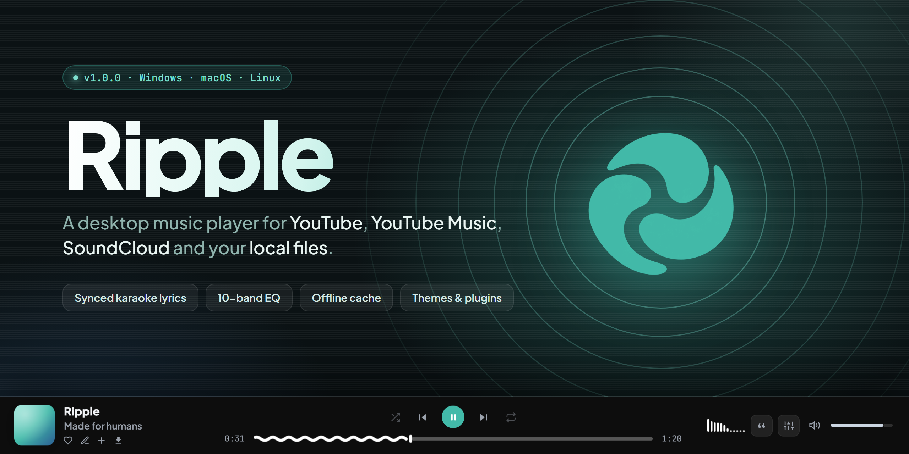

<p align="center">
  
</p>

<p align="center">
  <a href="https://github.com/Plipps45/Ripple/releases/latest"></a>
  
  
  <a href="LICENSE"></a>
</p>

# Ripple

**Ripple** is a lightweight desktop music player that brings **YouTube**, **YouTube Music**, **SoundCloud** and your **local music files** together in a single, beautiful app. It is built with **Tauri 2** and **Rust**, so it starts fast and uses a fraction of the memory of an Electron app, while the interface is crafted in plain HTML, CSS and JavaScript with a Material Design 3 look.

Search, stream, download, sing along with real-time synced lyrics, shape the sound with a 10-band equalizer and make the app your own with themes, custom CSS and plugins.

> [!IMPORTANT]
> Ripple is a **personal, educational project**. Please read the [Disclaimer](#disclaimer) before using it.

---

## Table of contents

- [Features](#features)
- [Tech stack](#tech-stack)
- [Installation](#installation)
- [Building from source](#building-from-source)
- [Keyboard shortcuts](#keyboard-shortcuts)
- [FAQ](#faq)
- [Disclaimer](#disclaimer)
- [License](#license)

---

## Features

### Search & discovery
- Unified search across **YouTube**, **YouTube Music** and **SoundCloud**, with a selectable default search engine.
- **Hide music videos** filter that drops "Official Video", "Lyric Video", MVs and visualizers so only the actual songs remain.
- Artist results inside search, plus **artist profiles** with popular tracks, albums and a live **biography** (Wikipedia, MusicBrainz and Wikidata).
- **Discover** home with the play queue, **Suggested albums** from the current artist, **My Ripple** recommendations, **Hot picks**, **Your daily** mix, **Your top tracks** and **Jump back in**.
- **Command palette** (`Ctrl + K`) to jump anywhere in the app.

### Playback
- Smart stream resolution: offline cache → downloads folder → short-lived URL cache → `yt-dlp`.
- **Automatic fallback**: if a platform refuses a track (DRM, bot checks…), Ripple finds the same song on another platform, preferring the original version with the right duration over remixes or covers.
- Background prefetching of the next track for gapless-feeling transitions.
- **Crossfade**, shuffle, repeat, a playback **queue** and a **sleep timer**.
- Adjustable **speed** and **pitch** (together or independently).
- **Offline library**: tracks are cached automatically (Opus 128k) after a few seconds of playback so they play again without a connection.

### Lyrics & karaoke
- **Real-time synced lyrics** from LRCLIB with **word-by-word karaoke** highlighting or line mode.
- **Automatic lyric offset for music videos**: Ripple correlates the audio of the video with the album version and shifts the lyrics to match long intros.
- **Lyrics translation** with optional auto-translate and a choice of target language.
- **Custom lyrics editor** to write or fix your own synced lyrics.
- Right-to-left script support (Arabic, Hebrew…).
- Full-screen **TV Karaoke** mode with optional visualizer and multiple lyric animation styles.

### Audio engine
- **10-band equalizer** plus quick Low / Mid / High controls, with savable, renamable **presets** and smooth preset transitions.
- **High Quality enhancement engine**: Vocal Clarity, High-End Air and Bass Depth.
- **Volume normalization**, volume gain, **reverb**, **echo** and **distortion** effects.
- Selectable **audio output device**.
- Real-time **audio visualizers** for the bottom bar, karaoke mode and lyrics panel.

### Library & playlists
- **Favorites**, **History**, and unlimited **playlists**.
- **My files**: play your local music folder alongside streaming sources.
- **Import playlists** from **Spotify**, **Apple Music** and **YouTube**, or from any supported link.
- **Edit track info** and **customize track art**.
- Sort tracks by title, artist, duration or date added.

### Downloads & editing
- Download tracks as **MP3, M4A, FLAC, Opus, WAV or OGG** with selectable bitrate, embedded metadata and cover art.
- **Trim audio** before downloading.
- Built-in **audio editor** that re-encodes your edits, with the option to bake in the current preset and effects.
- Configurable download folder.

### Personalization
- Light, dark and neutral **theme modes**, palette styles and a custom **accent color** (hue, intensity, brightness).
- **Mesh gradient** backgrounds that can follow the colors of the current cover.
- Track **banners** and custom **background media** (image or video) with blur, opacity and fade controls.
- UI scale, font scale, interface font (Plus Jakarta Sans, Google Sans, SF Pro or system), corner radius and opacity controls.
- **Custom themes** and a built-in **CSS editor** powered by Monaco.
- **Plugin system**: write small JavaScript plugins that react to player events.
- **Performance mode** and **Reduce motion** for slower machines.

### Desktop integration
- Custom frameless window with persistent size and position.
- **Mini player** (`P`) that also kicks in automatically on narrow windows.
- **System tray** with minimize-to-tray on close and single-instance support.
- **Global media keys** capture.
- **Windows taskbar thumbnail buttons**: shuffle, previous, play/pause, next and repeat.
- **Discord Rich Presence** showing what you are listening to.
- Animated launch intro and a first-run welcome screen.

### Under the hood
- Local HTTP server (axum) bound to `127.0.0.1` and protected with a per-session token.
- Audio proxy with SSRF protection and HLS rewriting.
- **Automatic installer for `yt-dlp` and `ffmpeg`** with SHA-256 verification and daily update checks.
- Cache management, diagnostics panel and log viewer in Settings.

---

## Tech stack

| Layer | Technologies |
| --- | --- |
| **Desktop shell** | [Tauri 2](https://tauri.app) (WebView2 on Windows, WKWebView on macOS, WebKitGTK on Linux) |
| **Backend** | [Rust](https://www.rust-lang.org) · [Tokio](https://tokio.rs) · [axum](https://github.com/tokio-rs/axum) · [reqwest](https://github.com/seanmonstar/reqwest) · serde · regex |
| **Frontend** | HTML5 · CSS3 (Material Design 3) · Vanilla JavaScript |
| **Audio** | Web Audio API · [Tone.js](https://tonejs.github.io) · [hls.js](https://github.com/video-dev/hls.js) |
| **Editor** | [Monaco Editor](https://microsoft.github.io/monaco-editor/) (custom CSS) |
| **Media tools** | [yt-dlp](https://github.com/yt-dlp/yt-dlp) · [FFmpeg](https://ffmpeg.org) |
| **Data sources** | YouTube · YouTube Music · SoundCloud · LRCLIB · Deezer · iTunes · Spotify · MusicBrainz · Wikipedia / Wikidata |
| **Integrations** | Discord Rich Presence (local IPC) |
| **Fonts** | Plus Jakarta Sans · JetBrains Mono |
| **CI / Packaging** | GitHub Actions · tauri-action · NSIS · DMG · DEB · RPM · AppImage |

---

## Installation

Download the installer for your system from the **[latest release](https://github.com/Plipps45/Ripple/releases/latest)**.

| System | File | How to install |
| --- | --- | --- |
| **Windows 10/11** | `Ripple_1.0.0_x64-setup.exe` | Run the installer. No admin rights needed (installs for the current user). |
| **macOS** (Apple Silicon & Intel) | `Ripple_1.0.0_universal.dmg` | Open the DMG and drag **Ripple** to **Applications**. |
| **Debian / Ubuntu** | `Ripple_1.0.0_amd64.deb` | `sudo apt install ./Ripple_1.0.0_amd64.deb` |
| **Fedora / openSUSE** | `Ripple-1.0.0-1.x86_64.rpm` | `sudo dnf install ./Ripple-1.0.0-1.x86_64.rpm` |
| **Any Linux** | `Ripple_1.0.0_amd64.AppImage` | `chmod +x Ripple_*.AppImage && ./Ripple_*.AppImage` |

On first launch Ripple downloads `yt-dlp` and `ffmpeg` automatically. You can also place them in the `bin/` folder or point to them with the `RIPPLE_YTDLP` and `RIPPLE_FFMPEG` environment variables.

> [!NOTE]
> The builds are not code-signed. On Windows, SmartScreen may show a warning: click **More info → Run anyway**. On macOS, if the app is reported as damaged, run `xattr -cr /Applications/Ripple.app` once.

---

## Building from source

**Requirements**

- [Rust](https://rustup.rs) (stable; MSVC toolchain on Windows)
- [Node.js](https://nodejs.org) 18 or newer
- The [Tauri prerequisites](https://tauri.app/start/prerequisites/) for your OS (WebView2 is already included in Windows 10/11)

**Steps**

```bash
git clone https://github.com/Plipps45/Ripple.git
cd Ripple
npm install
npm run dev      # run in development mode
npm run build    # optimized binary + installer in src-tauri/target/release/bundle
```

**Tests**

```bash
npm test                                          # unit tests + black-box HTTP API tests
cargo test --manifest-path src-tauri/Cargo.toml   # Rust tests
```

**Releasing:** pushing a tag such as `v1.0.0` runs the GitHub Actions workflow, which builds Windows, macOS and Linux installers and publishes them to a GitHub Release.

### Project structure

```
src/                 Frontend (HTML, CSS, JavaScript)
  app.js             UI logic, talks to the local backend over HTTP
  audio-engine.js    Web Audio graph: EQ, HQ chain, effects, normalization, analyzers
  styles.css         Base styles, themes and components
  redesign.css       Current layout
src-tauri/src/
  bridge.js          Injected bridge exposing native features to the page
  commands.rs        Tauri commands (window, dialogs, themes, plugins, cache…)
  window.rs          Window, mini player, tray and media keys
  thumbbar.rs        Windows taskbar thumbnail buttons
  discord.rs         Discord Rich Presence
  server/            Local HTTP API (search, streaming, downloads, lyrics, imports…)
```

App data lives in `%LOCALAPPDATA%\com.weebec.ripple` on Windows, `~/Library/Application Support/Ripple` on macOS and `~/.cache/ripple` on Linux. Set `RIPPLE_DATA_DIR` to change it.

---

## Keyboard shortcuts

| Action | Shortcut |
| --- | --- |
| Play / Pause | `Space` |
| Next / Previous | `Ctrl + →` / `Ctrl + ←` |
| Seek ±5 s | `Shift + →` / `Shift + ←` |
| Volume ±5 % | `Ctrl + ↑` / `Ctrl + ↓` |
| Mute / Unmute | `M` |
| Shuffle | `H` |
| Repeat | `R` |
| Lyrics | `L` |
| TV Karaoke | `F` |
| Mini player | `P` |
| Search | `/` or `Ctrl + K` |
| Close / Blur | `Esc` |

---

## FAQ

<details>
<summary><b>Is Ripple free?</b></summary>

Yes. Ripple is free and open source under the MIT License.
</details>

<details>
<summary><b>Do I need a YouTube, SoundCloud or Spotify account?</b></summary>

No. Searching and playing work without signing in. A Spotify connection is only used to import your playlists, and you can also import public playlists from a link.
</details>

<details>
<summary><b>Why does Ripple download yt-dlp and ffmpeg on first launch?</b></summary>

Ripple uses `yt-dlp` to resolve audio streams and `ffmpeg` to convert, trim and tag audio. Both are downloaded from their official GitHub releases, verified with SHA-256 and kept up to date automatically.
</details>

<details>
<summary><b>A track doesn't play. What can I do?</b></summary>

Ripple automatically tries the same song on another platform. If it still fails, update the tools from <b>Settings → Storage → Required tools</b>, clear the cache, and check <b>Settings → About → Logs</b> for details.
</details>

<details>
<summary><b>Where are my downloads and offline tracks stored?</b></summary>

Downloads go to the folder set in <b>Settings → Storage → Download folder</b>. Offline (cached) tracks live in the app data folder and can be cleared from <b>Settings → Storage → Offline library</b>.
</details>

<details>
<summary><b>The lyrics are out of sync. Can I fix them?</b></summary>

When a music video plays, Ripple measures the intro and shifts the lyrics automatically. You can also open the <b>Custom lyrics editor</b> to adjust or write your own synced lyrics.
</details>

<details>
<summary><b>How do I show Ripple on my Discord profile?</b></summary>

Enable <b>Settings → Integrations → Discord Rich Presence</b> while the Discord desktop app is running. You can use your own Discord Application ID there or with the <code>RIPPLE_DISCORD_CLIENT_ID</code> environment variable.
</details>

<details>
<summary><b>Can I write my own plugins or themes?</b></summary>

Yes. Use <b>Settings → Plugins</b> to create JavaScript plugins that react to player events, and <b>Settings → Custom themes</b> or the <b>CSS editor</b> to restyle the whole interface.
</details>

<details>
<summary><b>Windows or macOS says the app is unsafe. Is it a virus?</b></summary>

No. The installers are simply not code-signed, which triggers SmartScreen and Gatekeeper warnings. You can review the full source code in this repository and build it yourself.
</details>

---

## Disclaimer

> [!WARNING]
> **Ripple was created for educational and research purposes only.** It is a personal project to learn about desktop development with Tauri and Rust, audio processing with the Web Audio API and media handling.
>
> - Ripple is **not affiliated with, endorsed by or sponsored by** YouTube, Google, SoundCloud, Spotify, Apple, Deezer, Discord or any other service mentioned here. All trademarks belong to their respective owners.
> - Ripple does not host, store or distribute any copyrighted content. All media is fetched from third-party services at the user's request.
> - Users are solely responsible for how they use this software and must comply with the **terms of service** of each platform and with the **copyright laws** of their country. Please support artists by using official services.
> - The software is provided **"as is"**, without warranty of any kind. The author is not responsible for any misuse or damage arising from its use.

---

## License

Released under the [MIT License](LICENSE).

<p align="center">Made by <a href="https://github.com/Plipps45">Plipps45</a></p>
